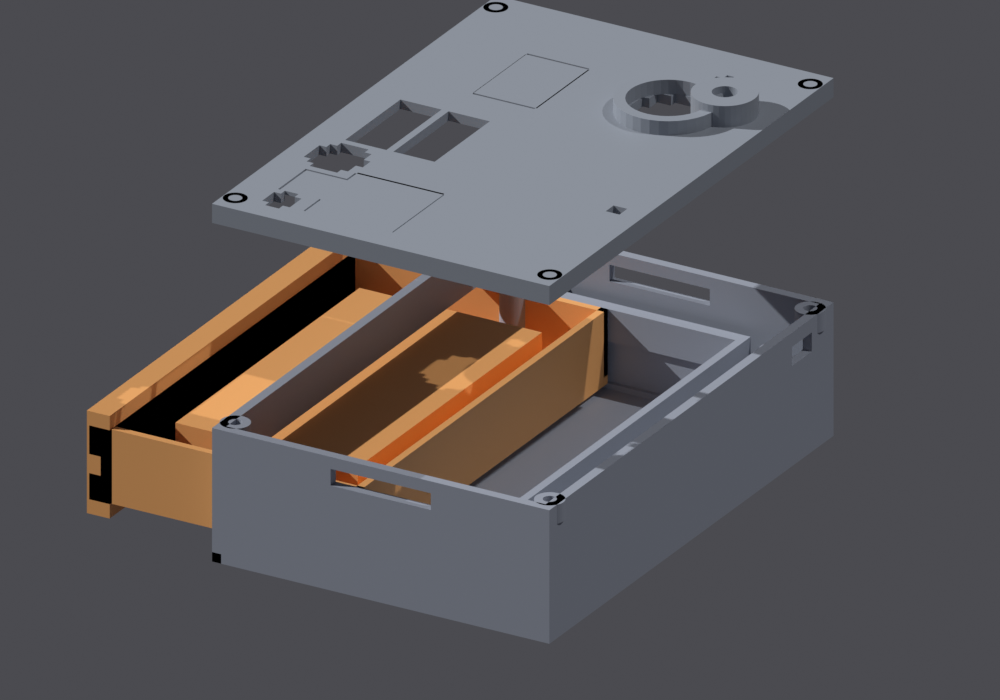

# Wapiti Trail Camera

Wapiti is an open-hardware cellular trail camera built for the harshest hunts: a 4K-capable IMX415 (8.4 MP) sensor on an SSC377Q SoC, a Cat-1bis LTE modem with eSIM (module selection reopened 2026-10-26 — see the [certification kickoff](docs/certification-kickoff.md#1-selection-cellular-module)), and an ESP32-C6 wake supervisor that owns the heartbeat, PIR/radar wakeups and cold-start power sequencing. It runs through −40 °C on drawer batteries plus solar (with a sub-zero charge interlock), backed by a 5 F supercap that rides through radio bursts. A mitten-friendly hi-vis battery drawer swaps packs in seconds, dual 940/850 nm IR illuminators cover day and night, and an LD2410 mmWave radar confirms presence before the main SoC ever wakes up. Tree straps and a ¼-20 tripod boss mount it to any tree; BLE-gated on-demand Wi-Fi pulls photos straight to a phone at the camera — no LTE data, no coverage needed. Every photo and clip is encrypted at rest with per-device keys, so a stolen camera or SD card yields hardware, never your media. Every artifact in this repo — schematics, footprints, PCB, chassis and renders — regenerates from Python scripts.

  
   <em>Exploded chassis view (lid, base, battery drawer). STLs, drawings and regeneration commands in the <a href="hardware/README.md">hardware guide</a>.</em>

## Documentation

| Document | What's inside |
| --- | --- |
| [Project plan](docs/project-plan.md) | Architecture, BOM & power budget (§4), Yocto firmware plan (meta-wapiti / yocto-cam) |
| [Test plan](docs/test-plan.md) | 307 test IDs across all subsystems, incl. YOCT-01…06 firmware bring-up |
| [Competitive analysis](docs/competitive-analysis.md) | Positioning vs Tactacam Reveal and peers; −40 °C power strategy (§4.2), mitten-swap chassis (§4.13) |
| [Tactacam Reveal research report](docs/tactacam-reveal-hunt-cameras-product-research-report.md) | Product research on the market-leading cellular trail camera |
| [Certification kickoff (WI-106)](docs/certification-kickoff.md) | §13 program: module/eSIM/lab selections, **estimated cost + lead time per certification**, $30–65k phase-1 budget |
| [Certification playbook (WI-106)](docs/wi-106-certification-playbook.md) | The ordered human checklist — approve → accounts → RFP → bookings → sign → close |
| [Hardware guide](hardware/README.md) | Schematic/PCB/chassis artifacts, regeneration commands, PCB↔chassis mapping, Value SKU (wapiti-lite) |

## Status (updated 2026-10-27)

**Done**
- **WI-101** Laravel + WebAuthn scaffold — `AUTH-01..18` green (Pest **and** HTTP catalog runs).
- **WI-102** Mongo schema + migrations — `MIG-01..05`, `PHP-01..03`/`PHP-05`, `SRV-01..03` green.
- **WI-103** nginx TLS site on :4444, builder/test one-shot images, `start-stop-services.sh` — `SVC-01..04`, `BLD-01..05` green.
- **WI-104** device ingest `/device/v1/*` — `ING-01..10` green (28/28 API run, 2026-10-27).
- **WI-106 deliverables drafted** (DRAFT, nothing sent/ordered): [certification kickoff](docs/certification-kickoff.md) with **cost + lead time per §13 row**, and the [human playbook](docs/wi-106-certification-playbook.md) — including the module requalification comparison/ranking and the 16-question vendor sheet (§8.3).
- **Test catalog:** 49 passed / 258 pending of 307 (latest runs in [`tests/reports/`](tests/reports/test-report.md)).

**Next session starts here**
1. **WI-106 Step 0 (human approval):** $30–65k phase-1 band · module ranking (EG916Q-GL → SIM7672G → SIM7672NA → EG91-NA) · lab shortlists. Then Step 1–2: send the [§8.3 question sheet](docs/certification-kickoff.md#83-vendor-question-sheet-send-verbatim-to-every-shortlisted-module-vendor--quectel--simcom-faes--before-any-poevk-spend) to Quectel + SIMCom and the §8.1 RFP to the labs.
2. **WI-105** camera simulator (`Dockerfile.sim` already ships; `SIM-01..06`).
3. **WI-107** FTO search commissioned (blocking for the S2 hardware freeze, §13.1).
4. **Open verification items** (kickoff §10): PTCRB device-search spot-check (JS-rendered), ISED CAB list, Bluetooth SIG fee schedule, and written answers to every `*`/`#` spec-sheet row.
5. **S2 device WIs (WI-201..206)** stay blocked until the module decision + EVK orders land.

**Not started:** S2–S5 work items, device firmware (Yocto/Zephyr), PWA/apps, and all lab-side certification work.

## Quick facts

- **Product:** cellular trail camera, 4K / 8.4 MP, radar-confirmed instant wakeups.
- **Value SKU:** **wapiti-lite** — same board with the LD2410 radar assembled DNP.
- **Connectivity:** LTE Cat-1bis + multi-IMSI eSIM (module requalification open — kickoff §1).
- **Power:** solar input with a <0 °C charge interlock, 5 F supercap ride-through for radio bursts.
- **Enclosure:** 108 × 74 × 33 mm chassis with 0.8 mm RF-window membranes; hi-vis mitten-swap battery drawer.
- **Firmware:** Yocto Linux — `meta-wapiti` BSP + `yocto-cam` image.
- **Reproducibility:** everything regenerates from the scripts in [`hardware/`](hardware/README.md) — no manual KiCad edits.
